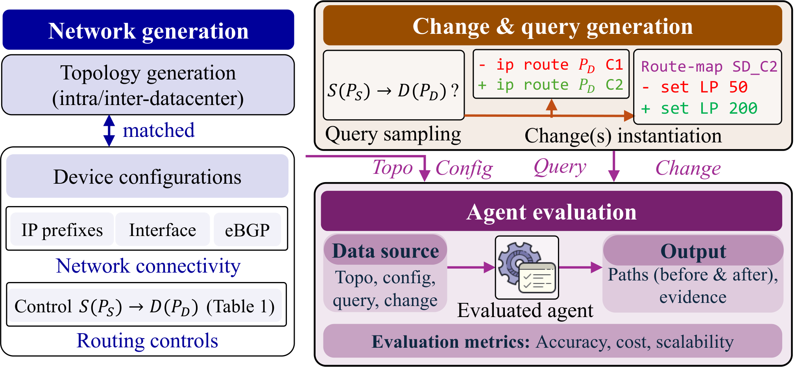

# RoutingBench

This repo implements RoutingBench which is proposed in our NeurIPS 2026 paper: [RoutingBench: Can Evidence-Based Agentic Routing Analysis Scale to Production Networks?](https://arxiv.org/abs/2609.22848). This benchmark evaluates different agentic methods for network routing-path analysis across network topologies, scales, and configuration changes. RoutingBench can serve as a foundation for preparing agentic NetOps technologies for production use.



Key components of this repo:

- **Network generators** under [`network/`](network/): generate fat-tree-based topologies, Cisco-IOS-style configurations at different network scales, configuration changes, and ground-truth paths before and after changes for three scenarios (intra-DC, inter-DC, and compound changes).
- **Three agents evaluated in the paper** under [`agents/`](agents/): *In-Context Learning*, *Iterative Reasoning*, and *Agent Skills* — each with its own guidance prompt, executor, and (for *Agent Skills*) a documented skill library plus deterministic tool scripts.
- **Evaluation framework** ([`agents/framework.py`](agents/framework.py)
  and [`agents/scalability_eval.py`](agents/scalability_eval.py)) for
  running individual cases (one case for a given change type and network) and batches of cases (e.g., all cases for given change type(s) at network scale(s)).
- **Log-analysis scripts** under [`analysis/`](analysis/) that turn raw
  run logs into the final results shown in the paper.

---

## Contents

- [Repository layout](#repository-layout)
- [Quick start](#quick-start)
  - [1. Install](#1-install)
  - [2. Configure your LLM API key](#2-configure-your-llm-api-key)
  - [3. Generate synthetic topology, configuration and changes](#3-generate-synthetic-topology-configuration-and-changes)
  - [4. Run an evaluation](#4-run-an-evaluation)
- [Full evaluation: reproducing paper results](#full-evaluation-reproducing-paper-results)
- [Citation](#citation)
- [License](#license)

---

## Repository layout

```
RoutingBench/
├── config.yaml                    # Model registry + evaluation defaults.
├── requirements.txt
├── LICENSE                        # MIT
├── README.md                      # ← you are here
│
├── generate_snapshot.py           # Sweep all config/topo/change generators.
├── network/                       # Config / topology / changes generators.
│   ├── TopoBase.py                # Fat-tree base templates.
│   ├── IntraDCNet.py              # Single-DC fat-tree (6 change types).
│   ├── InterDCNet.py              # Two-DC fat-tree (6 change types).
│   └── CompoundNet.py             # Multi-device compound scenarios.
│
├── agents/                        # LLM agents for path analysis.
│   ├── config_loader.py           # Reads top-level config.yaml.
│   ├── llm_client.py              # OpenAI-compatible Chat Completions wrapper.
│   ├── shared_prompts.py
│   ├── system_prompt*.md          # Case(Intra-/Inter-/Compund)-specific shared system prompts.
│   ├── framework.py               # Single-experiment runner.
│   ├── scalability_eval.py        # Sweep over k, parallel + resumable.
│   ├── in_context_learning/       # Method 1: In-Context Learning.
│   ├── iterative_reasoning/       # Method 2: Iterative Reasoning.
│   └── agent_skills/              # Method 3: Agent Skills
│       ├── AGENT.md               #   guidance prompt
│       ├── agent.py               #   executor (plan-invoke-reason loop)
│       ├── skill_executor.py      #   skill dispatcher
│       ├── rules/                 #   shared / topology-specific DON'T rules
│       ├── scripts/               #   9 deterministic config-introspection tools
│       └── skills/                #   14 skills, each with SKILL.md + run.py
│
└── analysis/                      # Log-analysis scripts (paper-table generators,
                                   #   per-tool profiler, wall-time recalibration).
```

---

## Quick start

### 1. Install

RoutingBench targets **Python 3.10+**. We recommend a fresh virtual
environment.

```bash
# Browse / download the repository at:
#   https://anonymous.4open.science/r/RoutingBench
# (anonymous.4open.science does not support `git clone`; use the
# "Download Repository" button on the page, then unzip.)
unzip RoutingBench.zip && cd RoutingBench
python3 -m venv .venv && source .venv/bin/activate
pip install -r requirements.txt
```

That's all — the only mandatory runtime dependencies are `openai`,
`PyYAML`, and `numpy`.

### 2. Configure your LLM API key

Every agent talks to the LLM through a thin OpenAI-compatible
[`agents/llm_client.py`](agents/llm_client.py) wrapper. The model
registry is declared in [`config.yaml`](config.yaml); credentials are
**always** loaded from environment variables — no API key ever lives in
the repository.

#### Pick a backend

You only need to set the env vars referenced by the model entry you plan
to use. The defaults work for any OpenAI-compatible provider:

```bash
# OpenAI (default base URL):
export OPENAI_API_KEY="sk-..."

# Self-hosted vLLM, Together, an internal proxy, etc.:
export OPENAI_API_KEY="..."
export OPENAI_BASE_URL="https://my-llm-proxy.example.com/v1"

# DeepSeek (already wired up in config.yaml as model `deepseek`):
export DEEPSEEK_API_KEY="..."
export DEEPSEEK_BASE_URL="https://api.deepseek.com"
```

#### Register a new model

To call a new model that isn't in the default registry, just add an entry
to [`config.yaml`](config.yaml) and reference it on the command line via
`--model <alias>`:

```yaml
models:
  my-model:
    deployment: my-model-name           # the actual id sent to the API
    api_key_env: MY_API_KEY              # env var holding the API key
    base_url_env: MY_BASE_URL            # env var holding the base URL
    # Optional, OpenAI o-series / DeepSeek style:
    # reasoning: high
    # extra_body:
    #   thinking:
    #     type: enabled
```

```bash
export MY_API_KEY="..."
export MY_BASE_URL="https://my-endpoint/v1"
python -m agents.framework --model my-model ...
```

#### Quick sanity check

```bash
OPENAI_API_KEY=sk-... python -c "
from agents.llm_client import call_llm
print(call_llm([{'role':'user','content':'say hi'}], model_name='gpt-4o').text)
"
```

### 3. Generate synthetic topology, configuration and changes

The generators are fully ***synthetic*** and analytical — every snapshot, every change diff,
and every `before_path` / `after_path` ground-truth label is produced
from deterministic templates. **No external network simulator is
needed.** With seed = 42 the output is reproducible bit-for-bit across
machines.

#### One topology at a time

| Topology family | Generator | What it produces |
|---|---|---|
| Single-DC fat-tree (intra-DC) | `python -m network.IntraDCNet <k>` | 6 single-device change types: `local_preference`, `med`, `static_route`, `bgp_network`, `prefix_aggregation`, `interface_shutdown` |
| Cross-DC fat-tree (inter-DC) | `python -m network.InterDCNet <k>` | same 6 change types, applied on either DC |
| Compound (multi-device) | `python -m network.CompoundNet <k>` | 4 scenarios: `compound_lp_bgpnet`, `compound_lp_shutdown`, `compound_lp_static_shutdown`, `compound_lp_static_bgpnet_shutdown` |

Each generator takes the topology parameter `k` (must be even, ≥ 4) and
optional `--num-pairs` and `--num-changes` flags (default 20 / 5):

```bash
python -m network.IntraDCNet 4                     # smallest fat-tree
python -m network.IntraDCNet 12 --num-pairs 20 --num-changes 5
python -m network.InterDCNet 8
python -m network.CompoundNet 16
```

#### [Optional] Advanced features
By default, RoutingBench randomly selects source/destination endpoint
pairs from the generated endpoints. For targeted evaluation, pass a JSON
file with explicit query pairs via `--pairs-file`:

```bash
python -m network.IntraDCNet 12 --pairs-file pairs.json
python generate_snapshot.py --topologies fattree compound --k 12 --pairs-file pairs.json
```

The file may be a plain list shared by the selected generators or an
object keyed by topology name:

```json
{
  "fattree": [
    {"src_edge": "edge-p0-e0", "dst_edge": "edge-p1-e0"},
    {"src_edge": [2, 1], "dst_edge": [5, 0]}
  ],
  "crossdc": [
    {"src_edge": "dc0-edge-p0-e0", "dst_edge": "dc1-edge-p1-e0"}
  ],
  "compound": [
    {"src_edge": "edge-p0-e0", "dst_edge": "edge-p2-e1"}
  ]
}
```

Single-DC and compound pairs must be inter-pod; cross-DC pairs are
interpreted as DC0 source to DC1 destination.

For large fat-tree scales that exceed IPv4 field ranges ($k>256$), the convenience
driver can also generate IPv6-addressed fat-tree base configurations:

```bash
python generate_snapshot.py --topologies fattree --k 4 --ipv6
```

The IPv6 path writes base router and host configs under
`data/fattree_v6/`. It does not generate change instances or query-pair
ground truth, so `--pairs-file` is only used by the IPv4 snapshot
generators above.

#### Sweep across every topology and every k

The convenience driver [`generate_snapshot.py`](generate_snapshot.py)
calls all three generators for every k value used in the paper:

```bash
# All three families, every default scale
python generate_snapshot.py

# A subset
python generate_snapshot.py --topologies fattree crossdc --k 4 8 12 16 20

# Custom sizing
python generate_snapshot.py --num-pairs 20 --num-changes 5
```

Output tree per (topology, k):

```
data/<topology>/<topology>k<NNN>/
  before/                                    # baseline configs + topology JSON
  <change_type>/pair<i>_change<j>/change.json
  ground_truth.json | compound_ground_truth.json
```

Where `change.json` is a list of `{device, add_lines, description}`
records, applied as a literal append before the trailing `end` of each
listed device. Three non-obvious conventions are worth calling out:

- **`bgp_network` changes always carry an accompanying `ip route` line.**
  Cisco IOS only honours a `network <prefix> mask <mask>` statement
  under `router bgp` if the exact prefix is already present in the
  device's local routing table (typically a static route or a directly
  connected interface). Without an accompanying `ip route`, the BGP
  advertisement would silently never appear. We therefore emit *both*
  the `ip route` and the `router bgp ... network ...` line, which is
  also how operators do it in practice.

- **Changes are applied by *appending* lines rather than rewriting
  blocks.** Cisco IOS evaluates configuration in the order it is parsed
  and the *most recently parsed* statement that matches a flow wins
  (e.g., the latest `route-map ... permit <seq>`, the latest BGP
  neighbor command, the latest `ip route` for the same prefix).
  Operators in production push incremental CLI commands that override
  earlier configuration for the same flow rather than re-pushing a
  complete configuration file. Our `add_lines` semantics mirror this:
  each change appends new lines to the existing `.cfg`, and the
  resulting file is what would be running on the box after the operator
  hits Enter. (See the module docstring in
  [`network/IntraDCNet.py`](network/IntraDCNet.py) for the same notes
  next to the generator code.)

- **Generated changes may contain duplicates.** For some combinations of
  topology size, change type, and selected source–destination pair, the
  number of distinct valid changes may be smaller than the requested
  `--num-changes`. In these cases, some selected changes may be repeated,
  so different change IDs may correspond to identical configuration changes.

### 4. Run an evaluation

There are two entry points. Use [`agents.framework`](agents/framework.py)
to run **one experiment** (one topology, one k, one method or all three)
and [`agents.scalability_eval`](agents/scalability_eval.py) to run **a
parallel sweep across many k values** with crash-resume.

The three reference baselines are:

| Method | Module | Description |
|---|---|---|
| `in_context_learning` | [`agents/in_context_learning/agent.py`](agents/in_context_learning/agent.py) | All device configs concatenated into a single prompt. |
| `iterative_reasoning` | [`agents/iterative_reasoning/agent.py`](agents/iterative_reasoning/agent.py) | LLM iteratively requests configs of specific devices. |
| `agent_skills` | [`agents/agent_skills/agent.py`](agents/agent_skills/agent.py) | Skill-based agent that selects from 14 documented skills, each backed by deterministic config-introspection tools. |

#### `agents.framework` — single experiment

```bash
python -m agents.framework     --topology fattree \                # fattree | crossdc | compound
    --k 4 \                              # any generated k value
    --method all \                       # in_context_learning | iterative_reasoning | agent_skills | all
    --model gpt-4o \                     # any alias in config.yaml's models:
    --limit 6 \                          # run on 6 instances per change type (omit = all)
    --change-type local_preference \     # restrict to one change type (optional)
    --output-dir logs                    # output root (default: logs)
```

Defaults come from `evaluation:` in [`config.yaml`](config.yaml); every
field can be overridden on the command line. After the run completes,
`logs/<topology>_<method>_k<K>_<model>_<ts>/` contains:

- `config.json` — what was run
- `<method>_<change_type>_p<pair>_c<change>.json` — per-instance log
- `all_results.json`, `summary.json` — aggregated metrics

Common change-type filters:

| Topology | Allowed `--change-type` values |
|---|---|
| `fattree` / `crossdc` | `local_preference`, `med`, `static_route`, `bgp_network`, `prefix_aggregation`, `interface_shutdown` |
| `compound` | `compound_lp_bgpnet`, `compound_lp_shutdown`, `compound_lp_static_shutdown`, `compound_lp_static_bgpnet_shutdown` |

##### Examples

```bash
# 1. Smoke test: 1 instance per change type on the smallest fat-tree
python -m agents.framework --topology fattree --k 4 --limit 1

# 2. Skill-based agent only, on cross-DC k=8
python -m agents.framework --topology crossdc --k 8 \
       --method agent_skills --model gpt-5.4

# 3. Compound k=16 limited to one scenario
python -m agents.framework --topology compound --k 16 \
       --change-type compound_lp_bgpnet --limit 5
```

---

## Full evaluation: reproducing paper results

The paper sweeps three topology families × the eleven scales
`k ∈ {4, 8, 12, 16, 20, 30, 50, 80, 120, 160, 200}` × all three agent
baselines × every supported LLM. We run this end-to-end with
[`agents.scalability_eval`](agents/scalability_eval.py), which executes
many `(k, method, instance)` triples in parallel, retries on rate-limit
errors, and resumes from disk if interrupted.

### Step 1 — Run batch evaluations in parallel

For each LLM you want to evaluate, run one command per topology family
(intra-DC / inter-DC / compound). For example, the snapshots behind the
intra-DC table for GPT-5.4 is produced by:

```bash
python -m agents.scalability_eval \
    --topology fattree \                 # fattree | crossdc | compound
    --model gpt-5.4 \                    # any alias in config.yaml
    --methods in_context_learning iterative_reasoning agent_skills \
    --k-values 4 8 12 16 20 30 50 80 120 160 200 \
    --ch-num 100 \                       # paper uses 100 for GPT-5.4 / GPT-4o,
                                         # 30 for the other LLMs (rate limits)
    --workers 16 \                       # parallel LLM calls (default 8)
    --output-dir logs/new_scale          # output root
```

Repeat for `--topology crossdc` and `--topology compound`, and for every
other model alias (`gpt-4o`, `o3`, `deepseek`, `qwen`, `llama`, …). For
the four budget-constrained LLMs (`o3`, `deepseek`, `qwen`, `llama`) the
paper sets `--ch-num 30` to stay within rate limits; for `gpt-5.4` and
`gpt-4o` it uses the full `--ch-num 100`.

If the run gets interrupted, just re-launch with the same flags plus
`--resume` — the runner will skip any `(k, method, instance)` triple
that already has a per-instance JSON on disk:

```bash
python -m agents.scalability_eval --topology fattree --model gpt-5.4 --resume
```

#### Recommendation: run inside `tmux`

Long batch evaluations should be launched in a detachable shell so a dropped SSH
session doesn't kill the run:

```bash
tmux new -s rb -d "python -m agents.scalability_eval \
    --topology fattree --model gpt-5.4 --workers 16 2>&1 \
    | tee logs/fattree_gpt54.log"
tmux attach -t rb         # check progress
```

Each sweep writes raw per-instance logs to:

```
logs/new_scale/<topology>_<model>_<timestamp>/k<K>/details/<method>_<change_type>.json
```

This is the canonical layout the analysis scripts in the next step
expect. Once every `(topology, model)` pair you care about has a
populated tree there, move on to Step 2.

### Step 2 — Reproduce the paper figures and tables

Scripts under [`analysis/`](analysis/) consume the `logs/new_scale/`
tree and emit the figures and LaTeX tables in the paper. Run them in
this order:

```bash
# (a) Per-k summary printers — useful sanity check, also produce
#     intermediate JSON consumed by gen_appendix_tables.py.
python analysis/extract_fattree_per_k.py             # fattree per-k table
python analysis/extract_fattree_llm_summary.py       # cross-LLM fattree summary
python analysis/extract_compound.py                  # compound per-k
python analysis/extract_crossdc.py                   # crossdc per-k
python analysis/extract_per_change_type.py           # accuracy split by change type

# (b) Per-LLM intermediate JSONs (consumed by gen_appendix_tables.py).
python analysis/ft-llm.py                            # writes ft_llm_results.json
python analysis/ft-llm-agent.py                      # writes ft_llm_agent_results.json
python analysis/xdc-llm-agent.py                     # writes xdc_llm_agent_results.json
python analysis/cp-llm-agent.py                      # writes cp_llm_agent_results.json
python analysis/ch-llm-agent.py                      # writes ch_llm_agent_results.json

# (c) Generate every appendix LaTeX table.
python analysis/gen_appendix_tables.py               # writes appendix_tables.tex
```

---

## Citation

```bibtex
@inproceedings{ding2026routingbench,
  title     = {{RoutingBench}: Can Evidence-Based Agentic Routing Analysis Scale to Production Networks?},
  author    = {Ding, Wenlong and Niu, Zhixiong and Yang, Jianan and Zhang, Fajun and Zhang, Bo and Liang, Ling and Xiong, Yongqiang and Xu, Tianyin and Xu, Hong},
  booktitle = {Advances in Neural Information Processing Systems},
  year      = {2026}
}
```

---

## License

The code is released under the [MIT license](LICENSE).
